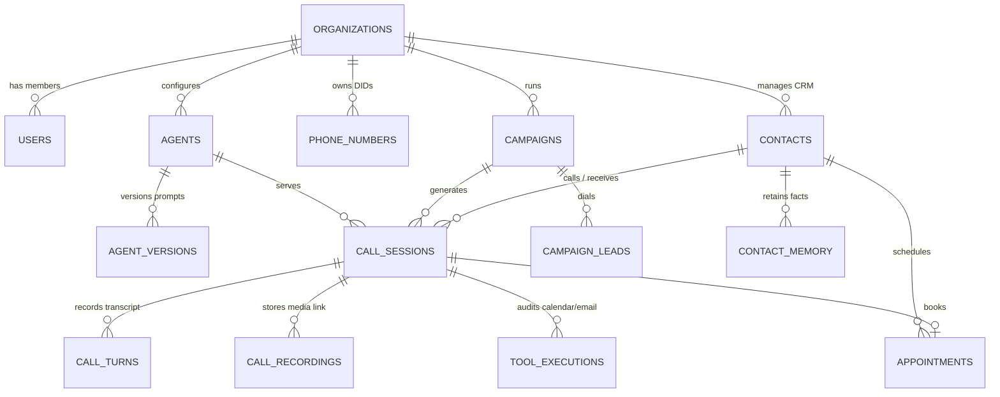

# 01. Database Schema Architecture

## 1. Overview & Architectural Goals

The voice platform currently relies on a lightweight MongoDB setup with two collections: `UserProfile` (CRM facts) and `Log` (conversation turns and binary audio). While functional for a prototype, this introduces serious production bottlenecks:
1. **Binary Audio in MongoDB:** Storing stereo PCM/WAV buffers in MongoDB documents quickly approaches the 16MB document cap and degrades Mongo's WiredTiger memory cache.
2. **Google Sheets as Campaign Database:** Outbound dialing relies on polling Google Sheets with row locks, risking race conditions and quota exhaustion.
3. **Missing Multi-tenancy & Access Control:** No data isolation between clients or operators.
4. **Unindexed Performance Metrics:** Turn latencies (STT lag, LLM TTFT, TTS latency) exist only as text logs rather than queryable metrics.

### The Target Solution
A **PostgreSQL (Relational Core) + S3/MinIO (Object Storage) + Redis (Active Sessions & Queues)** architecture.

---

## 2. Entity Relationship Diagram (ERD)



---

## 3. Core Table Specifications & Justifications

### 3.1 Tenancy & Agent Configuration
* **`Organization`**: Multi-tenant boundary isolating customer phone numbers, contacts, campaigns, and audio files.
* **`User`**: Admin, Operator, or Analyst with role-based access control (RBAC).
* **`Agent`**: Voice agent configuration (prompts, temperature, max tokens, STT provider settings, ElevenLabs voice ID, stability, similarity boost).
* **`AgentVersion`**: Immutable prompt versioning. When an engineer modifies Rahul or Priya's prompt, a historical snapshot is saved to prevent breaking in-flight calls and enable A/B testing.
* **`PhoneNumber`**: Inbound/Outbound telephony DID inventory mapped to Twilio or Smartflo trunks.

### 3.2 CRM, Contacts & Long-Term Memory
* **`Contact`**: Normalized telephone number identity (E.164 formatted), email, lead status (`lead`, `qualified`, `customer`, `dnd`), and lifetime call counters.
* **`ContactMemory`**: Long-term conversational memory facts captured across calls:
  * Key-value schema: `{ "budget": "$5000", "tech_stack": "Next.js", "interest": "Voxa24" }`.
  * Preserves context so Rahul can open with: *"Hey Amit, welcome back! Are you still looking to deploy Voxa24?"*

### 3.3 Call Sessions, Turns & Latency Telemetry
* **`CallSession`**: Primary call detail record (CDR). Stores call direction (`INBOUND`/`OUTBOUND`), telephony provider, timestamps, call outcome (`COMPLETED`, `BUSY`, `NO_ANSWER`), end-to-end average latencies, full transcript, and AI summary.
* **`CallTurn`**: Turn-by-turn conversation log with performance tracing:
  * `seq`: Turn index (1, 2, 3...)
  * `role`: `user` or `agent`
  * `text`: Spoken utterance
  * `sttDurationMs`: Deepgram STT transcription lag
  * `llmLatencyMs`: Time-to-First-Token (TTFT) from GPT-4o-mini
  * `ttsLatencyMs`: ElevenLabs synthesis latency
  * `totalLatencyMs`: End-to-end response time (turn taking delay)
  * `wasInterrupted`: Barge-in flag (caller talked over agent)
  * `unheard`: TTS chunks discarded on interruption
* **`ToolExecution`**: Detailed trace of external calls (`check_availability`, `book_appointment`, `send_meeting_email`), capturing latency and API payloads.

### 3.4 Decoupled Audio Storage (`CallRecording`)
Instead of storing audio in database documents, audio is uploaded to S3 / Google Cloud Storage / MinIO:
* `storageBucket`: `voxa-audio-prod`
* `storagePath`: `recordings/2026/10/call-HYD13-xxx.wav`
* `channelLayout`: Stereo (Left: Caller, Right: Agent)
* `waveformPeaks`: Precomputed JSON array of normalized audio amplitude peaks (`[0.05, 0.42, 0.88, ...]`) for instant zero-bandwidth waveform rendering in the frontend.

### 3.5 Outbound Campaigns & Appointments
* **`Campaign`**: Replaces Google Sheets. Holds dialing rules, concurrency limits (e.g. 2 concurrent calls), retry rules, and Indian calling hours (`09:30-19:00 IST`).
* **`CampaignLead`**: Individual lead states (`pending` $\rightarrow$ `calling` $\rightarrow$ `answered` $\rightarrow$ `converted` or `failed`).
* **`Appointment`**: Google Calendar bookings created during calls, including event IDs, meeting links, and confirmation email statuses.

---

## 4. Indexing & Partitioning Strategy

### 4.1 High-Throughput Indexes
```sql
-- Fast lookup during telephony webhook handling (Sub-5ms)
CREATE UNIQUE INDEX idx_call_session_sid ON "CallSession"("callSid");
CREATE INDEX idx_contact_phone ON "Contact"("orgId", "phoneNumber");

-- Active calls & live dashboard queries
CREATE INDEX idx_call_session_active ON "CallSession"("orgId", "status") 
WHERE "status" IN ('RINGING', 'IN_PROGRESS');

-- Campaign dialer queue (Fetch next pending leads within calling window)
CREATE INDEX idx_campaign_dialer_queue ON "CampaignLead"("campaignId", "status", "nextAttemptAt")
WHERE "status" IN ('pending', 'failed');

-- Recent call history & analytics
CREATE INDEX idx_call_session_started ON "CallSession"("orgId", "startedAt" DESC);
CREATE INDEX idx_call_turns_session_seq ON "CallTurn"("callSessionId", "seq" ASC);
```

### 4.2 Table Partitioning (Scale > 100k Calls/Month)
`CallTurn` and `CallSession` grow rapidly. For high-volume deployments, implement monthly range partitioning by `startedAt` / `timestamp`:
```sql
CREATE TABLE "CallTurn_2026_10" PARTITION OF "CallTurn"
    FOR VALUES FROM ('2026-10-01 00:00:00+00') TO ('2026-11-01 00:00:00+00');
```

---

## 5. Migration Strategy from Current MongoDB Setup

| Current MongoDB Schema | Target PostgreSQL / S3 Architecture | Transformation Notes |
| :--- | :--- | :--- |
| `UserProfile.phoneNumber` | `Contact.phoneNumber` | Normalize to E.164 (`+91...`). |
| `UserProfile.memory[]` | `ContactMemory` rows | Unroll `[{ key, value }]` into relational rows with `contactId`. |
| `Log.callSid` | `CallSession.callSid` | Unique index preserved. |
| `Log.turns[]` | `CallTurn` rows | Map turns into sequential rows with turn latencies. |
| `Log.recording.audioData` (Buffer) | AWS S3 / MinIO Object + `CallRecording` row | Extract buffer, upload WAV to S3, record URI and byte length in PostgreSQL. |
| `Google Sheet (Leads)` | `Campaign` + `CampaignLead` | Ingest Google Sheet rows into SQL with transactional claiming. |

The Prisma schema is saved in [schema.prisma](file:///Users/apple/Desktop/Voice/architecture/schema.prisma).
