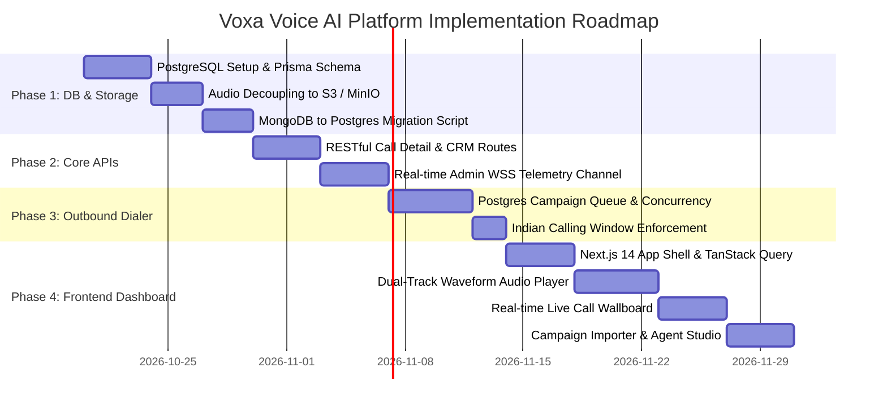

# 04. System Overview, Latency Budget & Implementation Roadmap

## 1. End-to-End System Architecture

The following diagram illustrates the complete end-to-end voice AI platform, integrating the **Database Schema**, **API Layer**, and **Frontend Dashboard**:

```
                       ┌───────────────────────────────┐
                       │     CALLER (PSTN / Mobile)    │
                       └───────────────┬───────────────┘
                                       │ Voice Call
                                       ▼
                       ┌───────────────────────────────┐
                       │  Telephony Trunk (Smartflo /  │
                       │           Twilio)             │
                       └───────────────┬───────────────┘
                                       │ Inbound Webhook / Outbound CTC
                                       ▼
                       ┌───────────────────────────────┐
                       │    VOICE ENGINE (Node.js)     │
                       │   WSS /ws/media (μ-law 8kHz)  │
                       └───────┬───────────────┬───────┘
           Audio Chunks        │               │ Synthesized PCM16 -> μ-law
           (20ms frames)       ▼               ▲
               ┌───────────────────┐       ┌─────────────────────┐
               │   Deepgram STT    │       │   ElevenLabs TTS    │
               │ (Nova-2 / Flux)   │       │ (Flash / Turbo v2.5)│
               └─────────┬─────────┘       └──────────▲──────────┘
           Transcripts   │                            │ Spoken Sentences
                         ▼                            │
               ┌──────────────────────────────────────┴──────────┐
               │      Agent Orchestrator (LangGraph State)       │
               │    GPT-4o-mini / Llama 3.1 70B (Groq)           │
               └─────────┬────────────────────────────┬──────────┘
       Tool Calls        │                            │ Context & Lead Facts
                         ▼                            ▼
               ┌───────────────────┐        ┌─────────────────────┐
               │ External Services │        │   PostgreSQL Core   │
               │ • Google Calendar │        │ • Contacts & Memory │
               │ • Nodemailer SMTP │        │ • Call Turns & CDR  │
               │ • Smartflo CTC    │        │ • Outbound Campaign │
               └───────────────────┘        └──────────┬──────────┘
                                                       │
                                  Stereo WAV (L/R)     │ S3 Object URI
                                  ┌────────────────────┴────────────────┐
                                  │ AWS S3 / MinIO (Decoupled Storage)  │
                                  └────────────────────┬────────────────┘
                                                       │
                                                       ▼
                                  ┌─────────────────────────────────────┐
                                  │   NEXT.JS 14 OPERATOR DASHBOARD     │
                                  │ • Dual-Track Waveform Audio Player  │
                                  │ • Real-time Live Wallboard (WSS)    │
                                  │ • Campaign Dialing Control Desk     │
                                  │ • Agent Studio & Persona Sandbox    │
                                  └─────────────────────────────────────┘
```

---

## 2. Telephony Latency Budget (Target: 600–800 ms)

In human phone conversations, pauses longer than 800–1000ms feel awkward or unnatural, causing callers to interrupt or ask *"Are you there?"*. The system achieves a sub-800ms turn-taking budget through the following breakdown:

```
0ms                  200ms                450ms                700ms         800ms
├────────────────────┼────────────────────┼────────────────────┼─────────────┤
│   Deepgram STT     │   LLM Processing   │   ElevenLabs TTS   │ Telephony   │
│   (VAD + Flux EOT) │   (Time to First   │   (First Chunk     │ Jitter &    │
│                    │    Token - TTFT)   │    Synthesis)      │ Playhead    │
└────────────────────┴────────────────────┴────────────────────┴─────────────┘
```

| Component | Target Budget | Optimization Strategy |
| :--- | :--- | :--- |
| **STT (Deepgram Nova-2 / Flux)** | **180 – 220 ms** | Direct 8kHz $\mu$-law streaming (zero transcoding); Multilingual hints (`hi,en`); EOT threshold set to `0.7`. |
| **LLM (GPT-4o-mini / Groq)** | **200 – 250 ms** | Streaming tokens with `createSentenceChunker()`; short prompt design; optional migration to Groq (Llama 3.1 70B TTFT $\approx$ 90ms). |
| **TTS (ElevenLabs Turbo / Flash)** | **200 – 260 ms** | Sentence-by-sentence streaming; server startup handshake pre-warming (`warmTTS()`); pre-synthesized tool filler phrases (*"Let me check that slot for you..."*). |
| **Audio Transcoding & Delivery** | **20 – 50 ms** | Optimized 2:1 low-pass downsampling in pure JS without external `ffmpeg` process spawning. |
| **Total Round-Trip Latency** | **600 – 780 ms** | **Meets natural conversational turn-taking benchmark.** |

---

## 3. Phased Implementation Roadmap



### Phase 1: Database Migration & Storage Decoupling (Week 1–2)
1. **Deploy PostgreSQL:** Apply [schema.prisma](file:///Users/apple/Desktop/Voice/architecture/schema.prisma) using `npx prisma db push` or `prisma migrate dev`.
2. **Audio Upload to S3:** Modify `src/utils/callRecorder.js` and `callSession.js` to upload completed stereo WAV buffers directly to AWS S3 or MinIO, storing only the object URI in `CallRecording`.
3. **Data Migration:** Run migration script to move existing `UserProfile` documents into `Contact` / `ContactMemory` and `Log` documents into `CallSession` / `CallTurn`.

### Phase 2: Core APIs & Real-time Telemetry (Week 3)
1. Implement REST endpoints (`/api/v1/calls`, `/api/v1/contacts`, `/api/v1/appointments`).
2. Integrate Redis Pub/Sub with the new supervisor WebSocket (`/ws/admin`) to stream live turn latencies and audio RMS meters to operator clients.

### Phase 3: Outbound Campaign Engine (Week 4)
1. Transition `outboundDialer.js` from Google Sheets polling to querying `CampaignLead` rows in PostgreSQL.
2. Implement transaction-safe lead claiming (`SELECT ... FOR UPDATE SKIP LOCKED`) with strict rate limiting and calling hours enforcement (`09:30-19:00 IST`).

### Phase 4: Next.js Frontend Dashboard (Week 5–6)
1. Scaffold Next.js 14 (App Router) project with TailwindCSS and Shadcn/ui.
2. Build the **Dual-Track Waveform Player** with synchronized transcript highlighting and latency waterfall graphs.
3. Build the **Live Call Wallboard** subscribed to `/ws/admin` for real-time monitoring.
4. Deploy the **Campaign Desk** with CSV lead import and concurrency slider controls.

---

## 4. Index of Architecture Files Created

All architectural blueprints are organized in the `architecture/` directory:

* **[schema.prisma](file:///Users/apple/Desktop/Voice/architecture/schema.prisma)** — Complete, production-ready Prisma schema for PostgreSQL.
* **[01_DATABASE_ARCHITECTURE.md](file:///Users/apple/Desktop/Voice/architecture/01_DATABASE_ARCHITECTURE.md)** — Relational ERD, table designs, S3 audio decoupling, indexes, and migration guide.
* **[02_API_ARCHITECTURE.md](file:///Users/apple/Desktop/Voice/architecture/02_API_ARCHITECTURE.md)** — REST API specifications, telephony webhooks, duplex media streaming, and real-time admin WebSocket protocol.
* **[03_FRONTEND_ARCHITECTURE.md](file:///Users/apple/Desktop/Voice/architecture/03_FRONTEND_ARCHITECTURE.md)** — Next.js 14 frontend architecture, component tree, dual-track WaveSurfer audio player, and live wallboard.
* **[04_SYSTEM_OVERVIEW_AND_ROADMAP.md](file:///Users/apple/Desktop/Voice/architecture/04_SYSTEM_OVERVIEW_AND_ROADMAP.md)** — End-to-end architecture diagram, latency budgets, and phased delivery roadmap.
